<div align="center">


[](https://github.com/YdvAkash)
[](https://www.linkedin.com/in/akashyadav0522/)
[](https://aradhana.ogakash.xyz/)

**BACKEND ENGINEERING · FULL-STACK PRODUCTS · AI-ASSISTED WORKFLOWS**

</div>


## 01 / IDENTITY PROTOCOL

> **Operator:** Akash Yadav  
> **Mission focus:** backend systems, full-stack product engineering, and practical AI integrations  
> **Design principle:** ship useful software with clear architecture and a thoughtful developer experience.

I build across the application stack—from API design and data layers to user-facing interfaces and deployment workflows. I’m especially interested in making the pieces work together reliably: predictable APIs, useful products, maintainable code, and infrastructure that can be understood by the next engineer.

```text
AKASH.YADAV  /  ENGINEERING PROFILE
━━━━━━━━━━━━━━━━━━━━━━━━━━━━━━━━━━━━━━━━
FOCUS       Backend systems · APIs · product engineering
CORE        Java · Spring Boot · Node.js · React
DATA        MongoDB · PostgreSQL · MySQL · Redis/Valkey
DELIVERY    Docker · GitHub Actions · AWS · Linux · Nginx
EXPLORING   System design · distributed systems · AI products
━━━━━━━━━━━━━━━━━━━━━━━━━━━━━━━━━━━━━━━━
```


## 02 / TECHNOLOGY CONSTELLATION

A compact map of the tools I work with and explore—grouped by how they fit together rather than as one long badge wall.

| **01 — LANGUAGES** | **02 — BACKEND & API** | **03 — CLIENT** |
|:---|:---|:---|
| Java · JavaScript · TypeScript | Spring Boot · Node.js · Express | React · React Native · Tailwind CSS |

| **04 — DATA SYSTEMS** | **05 — CLOUD & DELIVERY** | **06 — ENGINEERING TOOLS** |
|:---|:---|:---|
| MongoDB · PostgreSQL · MySQL · Redis/Valkey | AWS · Docker · Linux · Nginx | Git · GitHub Actions · Postman |


## 03 / PROJECT MISSION DOSSIERS

### 

**[MEDIVA / MED-DOC ↗](https://github.com/YdvAkash/med-doc-app)**

A medical-document organization and health-history application. Its repository README documents uploading and organizing reports and prescriptions, a health timeline, authenticated profiles, and an AI assistant for asking questions about reports.

**Documented client stack:** React Native · Expo · TypeScript · Zustand · React Navigation · Axios.

[Explore the repository and release history →](https://github.com/YdvAkash/med-doc-app)

### 

**[TURTLE — BOOK & WATCHLIST ↗](https://github.com/YdvAkash/Turtle)**

A MERN application for searching books, movies, and anime, rating items, building a watchlist, and viewing other users’ watchlists. The project includes Docker-based developer setup instructions.

**Documented stack:** MongoDB · Express · React · Node.js · Docker.

*Scope note:* the Turtle README lists authentication and recommendation features as future enhancements, so they are not described as shipped capabilities.

### 

**[FINDETECT AI — FRONTEND REPOSITORY ↗](https://github.com/YdvAkash/FinDetect-Ai-Frontend)**

The current accessible README identifies the project but does not document its feature set or architecture. The dossier intentionally stays at that verified level rather than guessing what the application does.

[Inspect the source repository →](https://github.com/YdvAkash/FinDetect-Ai-Frontend)

**More work:** [Browse all public repositories →](https://github.com/YdvAkash?tab=repositories)


## 04 / LIVE GITHUB TELEMETRY

<div align="center">


</div>

<sub>These cards depend on a third-party service and can be delayed or unavailable. They are a convenience layer, not a source-controlled metric; the profile and repository links above remain the fallback.</sub>


## 05 / ESTABLISH A CONNECTION

<div align="center">

**Have a useful problem to solve or a product worth building?**

[](https://github.com/YdvAkash)
[](https://www.linkedin.com/in/akashyadav0522/)
[](https://aradhana.ogakash.xyz/)


<sub>DESIGNED IN CURIOSITY · BUILT WITH CODE · ALWAYS ITERATING</sub>

</div>

---

<sub>Profile visuals are hand-authored SVG files stored in this repository. The README uses no custom JavaScript or site-only CSS; motion is decorative, and essential profile content remains available as text if animations are unsupported.</sub>
