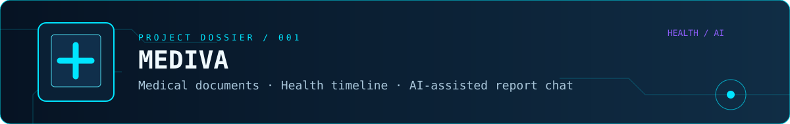
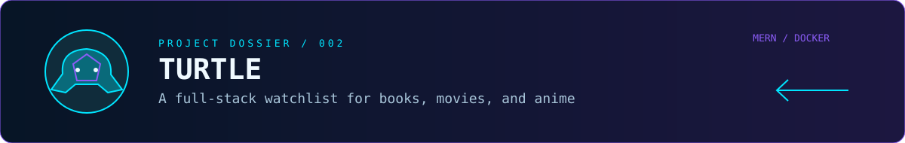
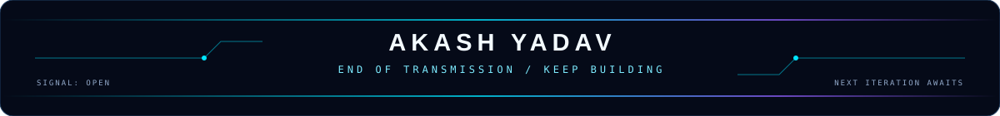

<div align="center">



[](https://github.com/YdvAkash)
[](https://www.linkedin.com/in/akashyadav0522/)
[](https://aradhana.ogakash.xyz/)

**BACKEND ENGINEERING · FULL-STACK SYSTEMS · AI-POWERED PRODUCTS**

</div>


## `01 / IDENTITY PROTOCOL`

```text
┌─ AKASH.YADAV / DEVELOPER PROFILE ──────────────────────────┐
│  STATUS     : BUILDING                                     │
│  FOCUS      : Backend systems · APIs · product engineering │
│  TOOLKIT    : Java · Spring Boot · Node.js · React          │
│  PRINCIPLE  : Useful software, clear architecture           │
└─────────────────────────────────────────────────────────────┘
```

I'm Akash Yadav, a developer interested in building useful digital products across backend engineering, full-stack development, cloud deployment, and AI-assisted workflows. I enjoy connecting clean APIs, thoughtful interfaces, reliable data layers, and practical deployment pipelines into complete applications.

- **Backend:** Java, Spring Boot, Node.js, Express
- **Frontend:** React, React Native, TypeScript, Tailwind CSS
- **Data:** MongoDB, PostgreSQL, MySQL, Redis / Valkey
- **Build & delivery:** Docker, GitHub Actions, AWS, Linux, Nginx
- **Exploring:** distributed systems, system design, and AI product integrations


## `02 / TECHNOLOGY CONSTELLATION`

<div align="center">

| **01 — LANGUAGES** | **02 — BACKEND & API** | **03 — FRONTEND** |
|:---:|:---:|:---:|
|  |  |  |
|  |  |  |
|  |  |  |

| **04 — DATA SYSTEMS** | **05 — CLOUD & DELIVERY** | **06 — TOOLS** |
|:---:|:---:|:---:|
|  |  |  |
|  |  |  |
|  |  |  |

</div>


## `03 / PROJECT DOSSIERS`

### 

**MEDIVA / MED-DOC** · [Source repository ↗](https://github.com/YdvAkash/med-doc-app)

A medical-document organization and health-history application. Its repository describes document uploads and organization, a health timeline, and an AI assistant for asking questions about medical reports.

- **Implemented in repository README:** medical document management, timeline, AI report chat, authenticated profiles.
- **Stack documented:** React Native, Expo, TypeScript, Zustand, React Navigation, Axios.
- **Build path:** [Repository and releases](https://github.com/YdvAkash/med-doc-app).

### 

**TURTLE — BOOK & WATCHLIST** · [Source repository ↗](https://github.com/YdvAkash/Turtle)

A full-stack MERN application for searching books, movies, and anime, rating items, building a watchlist, and viewing other users' watchlists.

- **Stack documented:** MongoDB, Express, React, Node.js, Docker.
- **Developer setup:** the repository README documents local frontend/backend runs and Docker commands.
- **Note:** authentication and recommendation features are listed as future enhancements in its README, so they are not presented here as completed features.

### **FINDETECT AI — FRONTEND REPOSITORY** · [Source repository ↗](https://github.com/YdvAkash/FinDetect-Ai-Frontend)

The accessible repository README currently contains only the project name. I’m linking the repository without making claims about its features, architecture, or implementation until those can be verified.

### **MORE REPOSITORIES** · [Explore all public work ↗](https://github.com/YdvAkash?tab=repositories)


## `04 / GITHUB TELEMETRY`

<div align="center">


</div>

<sub>Telemetry cards are served by a third-party service and may be unavailable or delayed. They reflect the provider's accessible GitHub data; they are not a claim of private contribution access.</sub>


## `05 / CONNECT TO THE OPERATOR`

<div align="center">

**Have a project, engineering challenge, or collaboration in mind?**

[](https://github.com/YdvAkash)
[](https://www.linkedin.com/in/akashyadav0522/)
[](https://aradhana.ogakash.xyz/)



<sub>DESIGNED IN CURIOSITY · BUILT WITH CODE · ALWAYS ITERATING</sub>

</div>
